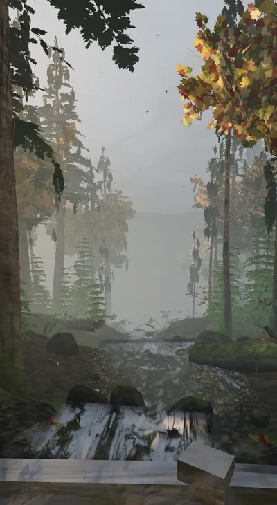

# Forest walk

<table>
  <tr>
    <td></td>
    <td></td>
    <td></td>
    <td></td>
  </tr>
  <tr>
    <td align="center">Footbridge</td>
    <td align="center">Morning sun</td>
    <td align="center">The falls</td>
    <td align="center">Rain</td>
  </tr>
</table>

**[Run it on your phone](https://codetik.dev/t/6484ee51-7cea-42b3-9d97-048550a00ed7)**.
Hold the bottom-left corner to walk, drag anywhere to look around.

A walk through a misty autumn forest, drawn in real time with WebGPU: old
conifers and golden maples, a creek with bridges and log crossings, a lake with
a boardwalk and a pier, weather that drifts from sun to fog, rain and storm,
jays, ravens and deer, and sound made entirely in code.

## How it works

- **No engine, no models.** Plain TypeScript and JavaScript with WGSL shaders,
  about 22,000 lines, no libraries. Nothing 3D is downloaded: the terrain,
  trees, plants, rocks, bridges and animals are built in code when it loads,
  from fixed seeds, so it is the same forest on every visit. The only image is
  the loading screen.
- **Terrain:** a density field computed on the GPU, turned into a mesh with
  surface nets.
- **Foliage:** trees and plants are instanced cards cut from a foliage atlas
  painted on the GPU at load. Near cards unfold into their branchlets; far
  trees cross-fade into silhouettes as the fog closes.
- **Light:** a shadow map baked once, light shafts through the canopy, bloom,
  automatic exposure and fog.
- **Sound:** Web Audio, every sound synthesised in code: steps by surface,
  rain, wind, thunder after each lightning flash, streams and birds. No audio
  files.
- **Phones first:** three quality tiers picked per device, the lowest baking
  its lighting at load; 30 frames a second held by changing the render size;
  load-time GPU work cut into small pieces, because one long job makes Android
  drop the GPU.

| File                                        | What it does                                |
| ------------------------------------------- | ------------------------------------------- |
| `src/main.ts`                               | entry: loading screen, touch controls       |
| `src/scene/scene.js`                        | renderer and frame loop                     |
| `src/scene/shaders.js`                      | all the WGSL shaders                        |
| `src/scene/world.js`                        | the generator: paths, streams, trees, props |
| `src/scene/quality.js`                      | quality tiers                               |
| `src/scene/sounds.js`, `src/scene/audio.js` | sound synthesis and mixing                  |

## How it was built

With AI coding agents and a person testing on real phones: one critic agent
that never writes code and judges every result against reference photos, one
builder agent that writes all the code, and a few agents that find reference
photos and recordings. [PROMPT.md](PROMPT.md) describes the method, what
phones taught us, and a starter prompt for building something like this with
your own coding agents (Claude Code, Codex, Cursor).

## Run it, change it

Forest walk is a _tik_: a small app for the [Codetik](https://codetik.dev)
feed, which runs offline on a phone.

**Build on it in Codetik.** Open the link above in the Codetik app and fork it:
your copy comes with an agent you can ask for changes, from a morning fog to a
snowy forest.

**Run it on your computer.**

1. Install [Node.js](https://nodejs.org) 22.12 or newer.
2. Install the Codetik command line tool: `npm install -g @codetik/cli`
3. Get the code:
   `git clone https://github.com/alexshelkov/forest-walk && cd forest-walk`
4. Start it: `codetik dev`, then open the address it prints in a browser with
   WebGPU (Chrome or Edge).

Point your coding agent at `AGENTS.md` and the `summary` in `tik.yaml` first:
they map the code and list the rules that keep it running on phones.
